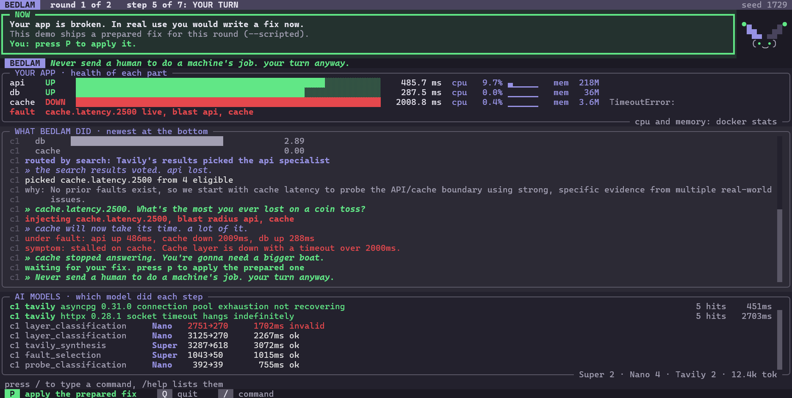
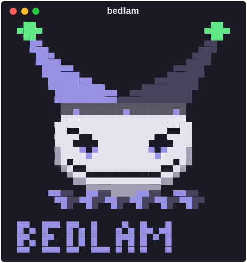

# Bedlam

An adversarial chaos agent for backend developers who fix an outage and ship
the patch hoping it holds.

Bedlam breaks a running three-tier FastAPI system, waits for you to patch it,
reads what your patch actually changed, and breaks it again from a direction
your patch did not cover. After two cycles it stops breaking things and
escalates to a performance trade-off that you choose -- it does not choose
for you.

<p align="center">
    
</p>

## Why a terminal, and why local

Bedlam is for the developer who has just patched an outage, and that developer
is already in a terminal next to Docker. The app it attacks runs on your
machine on purpose: Bedlam sends real faults to it, and Nebius's acceptable-use
policy forbids attack-like traffic against Nebius-hosted systems. Nebius runs
Bedlam's brain, never its victim.

## Limits, stated up front

- **Blast radius is bounded and computed before injection**, never discovered
  after. One fault, one layer, one cycle.
- **Termination is guaranteed**: two re-break cycles, then one trade-off
  escalation, then it stops. There is no open-ended loop.
- **Faults are injected sequentially.** Bedlam never breaks two layers at once,
  because the whole point is a clean causal link between one fault and one patch.
- **The target runs entirely on your machine.** Every decision Bedlam makes is
  a live Nemotron call on Nebius Token Factory, but Nebius never hosts the app
  being attacked.

## Status

Phases 1–4 complete: fault injection, the headless decision chain, the
terminal UI and the trade-off escalation run end to end. Now in rehearsal
and documentation (Phases 5 and 6). Still open: three clean runs in a row,
and a fresh clone on a second machine running from this README alone. See
`PLAN.md` for the build schedule and the current phase.

## Setup

Requires Python 3.12+, Docker with Compose, `make`, a Nebius Token Factory
API key and a Tavily API key (the free tier is enough).

```bash
git clone --recurse-submodules https://github.com/thisIsMadelyn/Bedlam---NVIDIA-Nebius-Hackathon-2026.git
cd Bedlam---NVIDIA-Nebius-Hackathon-2026
python -m venv .venv
source .venv/bin/activate   # Windows: .venv\Scripts\activate
pip install -e ".[dev]"
cp .env.example .env        # then fill in NEBIUS_API_KEY and TAVILY_API_KEY
make smoke                  # verifies both live APIs
make up                     # starts the target app, Postgres, Redis and Toxiproxy
make run SCRIPTED=1         # launches Bedlam with the prepared patches
```

If you cloned without `--recurse-submodules`, run `git submodule update --init`
before `make up`: the target app is a submodule in `targets/fastapi-boilerplate`.

At your turn, press P to hand over the fix. With `SCRIPTED=1`, Bedlam applies
one of the prepared diffs in `demo/patches/` that targets the live fault, and
reverts it when you quit. Without it (`make run`), Bedlam reads your own
`git diff` of `targets/fastapi-boilerplate`, so patch the app yourself before
pressing P. `make down` stops the stack and removes its volumes.

The [manual](docs/manual.md) covers the rest: the loop step by step, every key
and command, and what each part of the screen shows.

## The jester

<p align="center">
  
</p>

Bedlam has a face. The big jester holds the screen for 2.5 seconds at launch
(any key skips it). During the run a small one sits beside the NOW box and
changes mood with each step of the loop:

| Mood | Face | When |
|---|---|---|
| idle | `(◕‿◕)` | baseline, after the choice, finished |
| scheming | `(¬‿¬)` | a round starts, searching, routing, just before the trade-off |
| striking | `(ò▿ó)` | a fault is picked and injected |
| gloating | `(^▽^)` | your app shows a symptom, or the chosen cost bites |
| sulking | `(-_-)` | the fault did no visible damage |
| your turn | `(•‿•)` | waiting for your patch: the bells light green |
| reading | `(◉_◉)` | reading your patch |
| two-faced | `(◐‿◑)` | the trade-off: half option A, half option B |

Like Bedlam's voice, the jester is display only: no randomness, no model
call, and nothing it shows feeds a decision. The small jester appears from 93
columns up, so the screen stays fully readable at the 82-column minimum.

## Models and Nebius usage

Every decision Bedlam makes is a live call to NVIDIA Nemotron on Nebius Token
Factory. Nothing is pre-computed. Bedlam calls Token Factory through its
OpenAI-compatible endpoint at runtime, with seven call sites in each run's
loop. Without Token Factory, Bedlam can't pick a fault, read a search result
or judge a patch.

### Models

- `nvidia/nemotron-3-super-120b-a12b` (Super): the steps that need reasoning.
- `nvidia/NVIDIA-Nemotron-3-Nano-30B-A3B` (Nano): fast classification and
  extraction.

### Where each one runs

| Step | Model | Temp | Why this model |
|---|---|---|---|
| Classify the app's health from probes | Nano | 0.0 | Picks a label from a fixed list. No judgement needed |
| Write the Tavily search queries | Nano | 0.0 | Structured extraction: dependency, version, failure term |
| Label search results by layer | Nano | 0.0 | Classification that routes the round to a specialist |
| Analyse the developer's patch | Super | 0.1 | Reasoning over code: what the patch defends and what it leaves open |
| Turn search results into candidate faults | Super | 0.0 | Messy GitHub-issue prose into concrete hypotheses |
| Select the next fault | Super | 0.0 | The same evidence should lead to the same pick |
| Build the final trade-off | Super | 0.4 | The part the developer reads closely |

### How it's used

- **One file defines the models.** `bedlam/models/map.py` sets every call
  site's model, temperature, token limit and fallback, and nothing else in the
  code names a model.
- **Seeded.** Every call's seed comes from one root seed (`BEDLAM_SEED`).
  Token Factory is not fully deterministic even at temperature 0 with a fixed
  seed, so two live runs can still differ. The replay test in
  `LIMITATIONS.md` is what reproduces a run exactly.
- **Reasoning mode off.** Nemotron 3's thinking mode is switched off at every
  call site: each call asks for a small JSON object, and the full loop has to
  fit in a short demo.
- **Fallback is visible.** If Super fails, the call retries on Nano. The
  fallback is logged as a warning and flagged on screen, never silent.
- **Every call is on screen.** The AI MODELS panel shows each call as it happens:
  step, model, tokens, latency and outcome. `/calls` lists every model call
  per call site.
- **Bedlam's own voice is templated, not generated**, deliberately, for
  determinism.

### What I chose not to use

- **Nemotron Ultra:** too slow for a loop that has to finish inside a
  sub-3-minute demo.
- **Nemotron Lightning:** no step needs a 1M-token context.

Two models, each placed deliberately, beat four used for show.

The app Bedlam attacks never runs on Nebius. It runs in Docker on your own
machine, because Bedlam sends it real faults and Nebius's acceptable-use
policy forbids attack-like traffic against Nebius-hosted systems. Nebius runs
Bedlam's brain, never its victim.

## License

MIT. See `LICENSE`.
